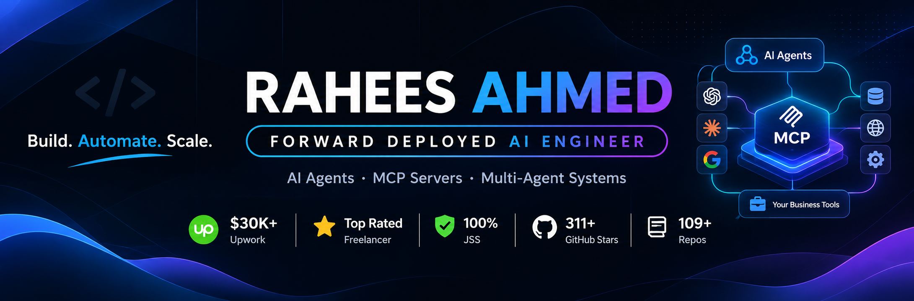

<div align="center">




**I build AI agents and MCP servers that do real work inside real businesses.**

[](https://upwork.com/freelancers/raheesahmed)
[](https://linkedin.com/in/raheesahmed)
[](https://raheesahmed.vercel.app)
[](mailto:rahesahmed37@gmail.com)

</div>

---

## About me

I find the repetitive workflows in a business that AI can take over, then build and deploy the complete system around the tools the business already uses: CRMs, databases, email, calendars, documents, websites and internal APIs.

I don't ship demos. I ship AI systems that are **reliable, observable, secure and maintainable** in production, with human approval wherever it matters.

```txt
$30,000+ earned on Upwork   ·   100% Job Success   ·   Top Rated
311+ GitHub stars           ·   109 public repos   ·   3 npm packages
10,000+ documents/day processed in production   ·   99.2% less processing time
```

**What I build:** AI agents and multi-agent systems · MCP servers and integrations · LangGraph workflows · RAG and knowledge systems · voice AI agents · business automation · full-stack AI apps (FastAPI + Next.js)

---

## Featured projects

### 🔧 MCP servers

| Project | What it does |
|---|---|
| [**YouTube Insights MCP**](https://github.com/RaheesAhmed/youtube-insights-mcp) | 🆕 Lets Claude analyze any YouTube channel and read your own YouTube Analytics: retention, traffic sources, subscribers per video. Google OAuth 2.1, MCP spec 2026-07-28 |
| [**WordPress MCP Server**](https://github.com/raheesahmed/wordpress-mcp-server) | 190+ tools for AI-managed WordPress: posts, pages, media, users, WooCommerce, themes, plugins, SEO, backups and files |
| [**Context Engine MCP**](https://github.com/raheesahmed/Context-Engine-MCP-Server) | Code intelligence: semantic search, architecture maps, call graphs, context retrieval and multi-file edits |
| [**QuickMCP**](https://github.com/raheesahmed/QuickMCP) | Production MCP framework with OAuth2, rate limiting, health checks and metrics |
| [**FLUX Protocol**](https://github.com/raheesahmed/flux-protocol) | Universal connectivity layer between AI systems and external tools and APIs |
| [**code-context-mcp**](https://github.com/raheesahmed/code-context-mcp) | Smart context and semantic search for AI coding workflows |

### 🤖 AI agent systems

| Project | What it does |
|---|---|
| [**SajiCode**](https://github.com/raheesahmed/sajicode) | 17-agent autonomous engineering CLI (1 PM, 6 leads, 10 sub-agents) that plans, codes, reviews and ships software |
| [**MediVoice AI**](https://github.com/raheesahmed/medivoice-ai) | Real-time voice AI for medical practices: inbound calls, bookings, prescription refills. FastAPI, Pipecat, LangGraph, Twilio, Deepgram |
| [**WorkFlow AI**](https://github.com/raheesahmed/workflowweb) | Turns spoken workflow ideas into n8n, Zapier or Make.com automations |
| [**n8nCopilot**](https://github.com/raheesahmed/n8nCopilot) | AI agent that generates n8n workflows, with structured memory |
| [**LangGraph Agents Template**](https://github.com/raheesahmed/LangGraph-Agents-Template) | Production-ready LangGraph starter with multiple agent patterns and streaming |
| [**Code to Cash**](https://github.com/raheesahmed/Code-to-Cash) | Multi-agent system that turns product ideas into shipped software |

<details>
<summary><b>🌐 More AI apps and tools</b></summary>

| Project | What it does |
|---|---|
| [**ContextPilot**](https://github.com/raheesahmed/ContextPilot) | Context retrieval that reduces hallucinations in AI coding |
| [**Browser Agent**](https://github.com/raheesahmed/browseragent) | Vision-first browser automation agent |
| [**WhatsApp Bot**](https://github.com/raheesahmed/WhatsApp-Bot) | AI WhatsApp chatbot with admin dashboard and analytics |
| [**Personal WhatsApp Assistant**](https://github.com/raheesahmed/Personal-WhatsApp-Assistant) | WhatsApp + LangChain personal assistant |
| [**AI Design Assistant**](https://github.com/raheesahmed/AI-Design-Assistant) | Gemini inside Adobe Illustrator for design analysis and image generation |
| [**OpenAI Assistant API with UI**](https://github.com/raheesahmed/OpenAI-Assistant-API-with-UI) | Full UI for the Assistants API with threads and streaming |
| [**eBook Architect**](https://github.com/raheesahmed/ebook-architect) | Turns an idea into a complete, structured eBook |
| [**Upcraft**](https://github.com/raheesahmed/upcraft) | AI tool that improves Upwork proposals and profiles |
| [**Apps Generator**](https://github.com/raheesahmed/Apps-Generator) | Generates full-stack apps from structured specs |

</details>

---

## How I work

```txt
1. Understand the workflow        →  what is slow, manual or error-prone
2. Design the agent architecture  →  agents, tools, memory, permissions
3. Build                          →  backend, MCP connections, dashboard, approval flow
4. Connect                        →  APIs, databases, documents, business systems
5. Test on real tasks             →  not demos
6. Deploy, monitor, improve
```

---

## Tech stack

**AI and agents**


**Backend and frontend**


**Data and infrastructure**


**Security I build in by default:** OAuth 2.1 · API keys · role-based access · audit logs · rate limits · human-in-the-loop approvals

---

## Certifications

**LangChain:** Deep Agents · LangGraph Essentials · LangChain Essentials
**DeepLearning.AI:** Generative AI for Everyone · Building Systems with the ChatGPT API · Prompt Engineering
**Google:** UX Design Certificate · [ORCID 0009-0008-1956-0514](https://orcid.org/0009-0008-1956-0514)

---

<div align="center">

### 💼 Open for work

**AI agents · MCP servers · RAG systems · workflow automation · custom AI tools**

Need an AI agent, a production MCP server, or AI connected to your existing systems? Let's talk.

[](https://upwork.com/freelancers/raheesahmed)
[](https://fiverr.com/aiintegration)
[](https://npmjs.com/~raheesahmed37)
[](mailto:rahesahmed37@gmail.com)

</div>
